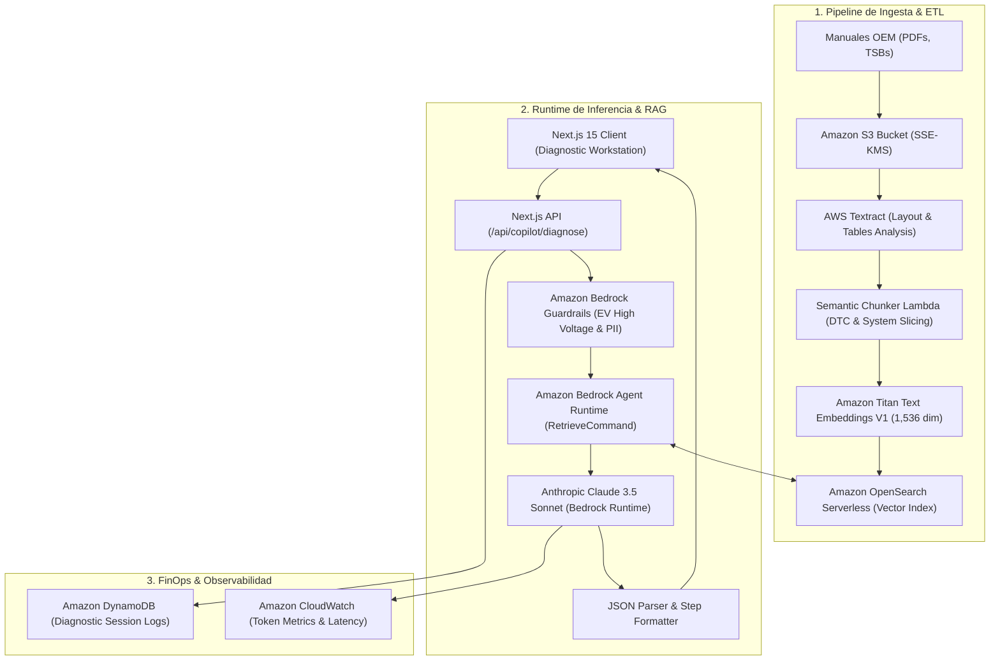

# ARCHITECTURE.md — Kasa AutoCopilot

## System Architecture & Data Engineering

This document outlines the technical architecture, data pipeline, vector search strategy, and security model of **Kasa AutoCopilot**.

---

## 1. Architectural Diagram



---

## 2. Ingestion Pipeline & Chunking Strategy

### Naive Chunking vs. Automotive Semantic Chunking
Standard RAG systems slice documents arbitrarily every 500 or 1,000 tokens. In automotive technical manuals, naive chunking fails because:
* A torque table loses its column headers, confusing cylinder head torque with camshaft cap torque.
* Multi-step diagnostic trees (e.g., *Pinpoint Test HC*) get cut midway through an electrical measurement step.
* High-voltage safety instructions get separated from the component removal steps.

### Kasa AutoCopilot's Hierarchical Chunking Policy:
1. **Parent-Child System Boundaries**: Documents are partitioned by Vehicle Subsystem (e.g., `Engine-Mechanical`, `Ignition-COP`, `HV-Battery`, `Emissions-Exhaust`).
2. **DTC Code Tagging**: Chunks containing diagnostic steps are indexed with explicit metadata attributes:
   ```json
   {
     "vin_pattern": "1FTFW1ED*",
     "oem_code": "WSM-303-07C",
     "dtc_tags": ["P0300", "P0301", "P0302"],
     "component": "Coil-on-Plug Ignition",
     "system": "POWERTRAIN",
     "page_number": 418,
     "has_torque_spec": true,
     "has_high_voltage": false
   }
   ```
3. **Table Extraction with AWS Textract**:
   Table structures are preserved in markdown table format within the embedding payload, ensuring tabular alignment is preserved when passed to Claude 3.5 Sonnet.

---

## 3. Foundation Models & Inference Engine

* **Retrieval Model**: `amazon.titan-embed-text-v1` (1,536-dimensional vectors with cosine similarity).
* **Generation & Reasoning**: `anthropic.claude-3-5-sonnet-20241022-v2:0` hosted natively on Amazon Bedrock in `us-east-1`.
* **Zero Data Retention**: Amazon Bedrock guarantees that customer telemetry and diagnostic queries are never used to train or fine-tune public foundation models.

---

## 4. Bedrock Guardrails & High-Voltage Safety Filter

When inspecting hybrid or battery electric vehicles (HEVs/BEVs) with 200V–800V DC architectures, the engine activates a mandatory safety prompt interceptor:
1. **Context Filter**: Scans for powertrain types `HEV`, `PHEV`, and `BEV`.
2. **Mandatory Intervention**: Injects required Lockout/Tagout (LOTO) procedures, Service Plug Grip extraction, and verified capacitor bleed-down countdowns before presenting multimeter test steps.
3. **PPE Verification**: Enforces Class 0 (1,000V rated) insulating gloves and arc flash shields.

---

## 5. FinOps Accounting Formula

$$\text{Query Cost} = \left(\frac{\text{Tokens}_{\text{in}}}{1,000} \times \$0.003\right) + \left(\frac{\text{Tokens}_{\text{out}}}{1,000} \times \$0.015\right) + \$0.0005_{\text{KB Retrieval}}$$

$$\text{ROI Multiplier} = \frac{\text{Technician Labor Saved} + \text{Avoided Misdiagnosis Part Cost}}{\text{Query Cost}}$$
